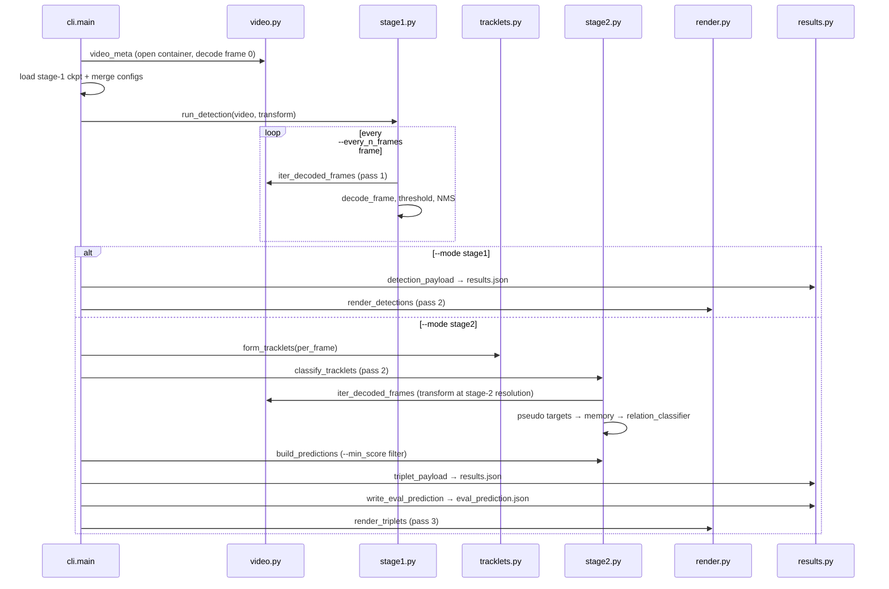

# Single-video inference — both modes, every parameter, and what the output can measure

Reference for `inference.py` / `vrdf_inference/`: running a trained VRDFormer on **one video that
has no annotations**, in detection-only mode or in the full triplet pipeline. Every claim carries a
`file:line`.

Companions: [`STAGE1.md`](STAGE1.md) (training + the missing stage-1 evaluation),
[`STAGE2.md`](STAGE2.md) (training + the implemented metrics). The design record and the
per-mode walkthrough live in [`RUNPOD_INFERENCE.md`](RUNPOD_INFERENCE.md); this document is the
parameter/output/metric reference, not a setup guide.

---

## 1. The two modes

| Mode | What it runs | Model(s) | Writes |
| --- | --- | --- | --- |
| `--mode stage1` | Detection only: decode the detector's 200 static queries per frame, threshold, NMS | `VRDFormer` (stage-1 weights) | `results.json` + annotated `video.mp4` |
| `--mode stage2` | Detection → tracklet association → per-tracklet relation classification → triplets | `VRDFormer` **and** `VRDFormer_S2` | `results.json` + `eval_prediction.json` + annotated `video.mp4` |

`--mode` is **required and has no default** (`vrdf_inference/cli.py:75-82`), so a cheap detection run
can never be mistaken for an expensive full run.

Stage 2 does **not** call stage-1 mode. Both modes call the same `run_detection`
(`vrdf_inference/cli.py:371-377`), and stage 2 consumes the detections it returns in memory; only
the `_run_stage2` branch then imports `tracklets` and `stage2`
(`vrdf_inference/cli.py:399-453`). That is why `--mode stage1` works on a machine with no stage-2
checkpoint.

### 1.1 Why stage 1 has to exist at inference

Stage 2 is an **oracle** classifier: its queries are initialized by `roi_align` on boxes it is given
(`models/transformer.py:139-160`) and its eval path predicts a verb per **ground-truth** pair
(`models/vrdformer_stage2.py:82-95`). On an unlabeled video there are no boxes to give it. Inference
therefore supplies them itself: detect (stage-1 weights) → associate into tracklets → present the
tracklets as pseudo-ground-truth to stage 2
(`vrdf_inference/stage2.py:1-7, 19-70`).



**Decode passes.** Stage 1 reads the video twice (detect, render); stage 2 reads it three times
(detect, classify, render). Rendering re-decodes rather than caching frames
(`vrdf_inference/render.py:127-137, 191-201`).

---

## 2. CLI parameters

The parser is `main.get_args_parser()` **plus** inference flags, with `conflict_handler="resolve"`
so `--dataset_config` can be re-registered (`vrdf_inference/cli.py:56-72, 83-91`). Every training
flag is therefore *accepted*; §2.3 lists the ones that do nothing.

### 2.1 Inference-only flags

| Parameter | Default | Type / choices | Effect | Line |
| --- | --- | --- | --- | --- |
| `--video` | *required* | path | Input `.mp4`; existence is checked before anything else | 74 |
| `--mode` | *required* | `stage1` \| `stage2` | Mode dispatch | 75-82 |
| `--video_id` | input stem | str | Output subdirectory name and payload `video_id` | 83-87 |
| `--stage1_ckpt` | `data/ckpts/vidorsmall_stage1/checkpoint0001.pth` | path | Stage-1 weights; missing file is fatal | 88-90 |
| `--stage2_ckpt` | `data/ckpts/vidorsmall_stage2/checkpoint.pth` | path | Stage-2 weights; read **only** in stage2 mode | 91-93 |
| `--stage1_config` | `configs/vidorsmall_stage1.json` | path | Stage-1 config | 94 |
| `--stage2_config` | `configs/vidorsmall_stage2.json` | path | Stage-2 config; read only in stage2 mode | 95 |
| `--output_dir` | `output/inference/<mode>` (effective) | path | **Per-mode parent**; artifacts land in `<output_dir>/<video_id>/`. The argparse default reads as `''` because the inherited `--output-dir` shares the `output_dir` dest; the code treats empty as unset and substitutes `output/inference/<mode>` | 97-102 |
| `--results_name` | `results.json` | str | Filename inside the per-video directory | 103 |
| `--video_name` | `video.mp4` | str | Annotated video filename | 104 |
| `--eval_prediction_name` | `eval_prediction.json` | str | `util/evaluate`-shaped sidecar; pass `""` to skip | 105-110 |
| `--every_n_frames` / `--stride` | `5` | int ≥ 1 | Decode stride over the source; also sets output fps = `fps / stride`. `< 1` is fatal | 112-119 |
| `--max_frames` | `None` | int | Cap on **decoded** frames (smoke tests) | 120-125 |
| `--decode_chunk` | `64` | int | Frames per decord batch; bounds peak memory | 126-131 |
| `--conf_sub` | `0.15` | float | Sigmoid threshold on the subject class score; the query is kept only if **both** subject and object clear their thresholds | 133-140 |
| `--conf_obj` | `0.15` | float | Same for the object class score | 141-146 |
| `--conf_verb` | `0.15` | float | **Reporting only**: whether the stage-1 verb is written into `results.json`. Never drops a detection | 147-153 |
| `--dedup_iou` | `0.9` | float | Per-frame NMS among queries of the same `(sub_cls, obj_cls)`, on `min(iou_sub, iou_obj)` | 154-159 |
| `--max_dets_per_frame` | `50` | int | Truncate to the top-`N` by `pair_score` **before** NMS | 160 |
| `--iou_thresh` | `0.3` | float | Minimum `min(iou_sub, iou_obj)` for a tracklet↔detection match | 162-167 |
| `--max_gap` | `2` | int | Decoded frames a tracklet stays matchable after a miss | 168-174 |
| `--min_tracklet_frames` | `1` | int | Drop tracklets observed in fewer decoded frames | 175-180 |
| `--cls_gate` | `motion` | `motion` \| `same` | `motion`: associate on box motion only; `same`: additionally require identical `(sub_cls, obj_cls)` | 181-187 |
| `--cls_vote` | `keep` | `keep` \| `first` | How a tracklet's reported classes are chosen: confidence-weighted vote over its frames, or the opening frame | 188-194 |
| `--min_score` | `0.05` | float | Drop a triplet whose **sigmoid** verb probability is below this | 196-201 |
| `--max_labels_per_frame` | `8` | int | **Render only**: how many of the most confident pairs/tracklets get a text label. Boxes are always drawn for all | 202-208 |
| `--stage1_resolution` | `None` | `small`/`middle`/`large` | Override the stage-1 transform resolution (beats the checkpoint) | 210-215 |
| `--stage2_resolution` | `None` | same | Override the stage-2 transform resolution | 216-221 |
| `--dataset` | `None` | str | Override the dataset name for **both** stages; drives class counts and default class-list paths | 222-226 |
| `--obj_list` | `data/<dataset>/obj.txt` | path | Object class names | 227-229 |
| `--action_list` | `data/<dataset>/action.txt` | path | Verb names | 230-232 |

### 2.2 Inherited flags that matter

| Parameter | Default | Effect at inference | Line |
| --- | --- | --- | --- |
| `--device` | `cuda` | `resolve_device`: a `cuda*` request with no CUDA **fails loudly** rather than falling back | `main.py:67`; `vrdf_inference/checkpoints.py:41-49` |
| `--seed` | `42` | Seeds `random`, NumPy, torch before any model construction | `main.py:68`; `cli.py:305-308` |
| `--num_queries` | `100` (argparse) → effectively **200** from the checkpoint | Decoder slots; also the cap on active tracklets per stage-2 frame | `cli.py:247-257`; `stage2.py:103-111` |

### 2.3 Accepted but ignored

Every training flag is accepted. These are read by nothing in `vrdf_inference/`:

| Flag(s) | Status |
| --- | --- |
| `--amp`, `--benchmark`, `--debug`, `--eval`, `--eval_mode`, `--eval_skip` | Not read; inference runs under `torch.set_grad_enabled(False)` and does not use autocast |
| `--lr`, `--lr_backbone`, `--lr_drop`, `--weight_decay`, `--optimizer`, `--clip_max_norm`, `--accumulate_steps`, `--epochs` | Training-only |
| `--set_cost_*`, `--*_loss_coef`, `--eos_coef`, `--focal_alpha`, `--focal_gamma` | Loss/matcher only; no loss is computed |
| `--pretrain`, `--resume` | Not used — checkpoints come from `--stage1_ckpt` / `--stage2_ckpt` |
| `--num_obj_classes` | Re-derived from the dataset name (`models/__init__.py:23`), so the flag does nothing |
| `--num_verb_classes` | **Not fully inert.** The real head width is re-derived from the dataset (`models/__init__.py:24`, 50 for vidorsmall), but the value here sizes the dummy `verb_labels` zeros in the pseudo-target (`vrdf_inference/stage2.py:65-67`). Those zeros are read by `memory_update` and ignored by the non-eval `relation_classifier`, so a mismatch is harmless — but the checkpoint's saved 132 is what takes effect |
| `--dataset_config` | Re-registered as a dummy so the inherited parser is satisfied (`cli.py:68-72`) |
| `--tracking` | **Overwritten to `False`** so `build_model` returns the base `VRDFormer`, not the tracking wrapper (`vrdf_inference/checkpoints.py:57-62`) |

---

## 3. How config and checkpoint merge

`resolve_stage_args` (`vrdf_inference/cli.py:236-260`) combines four layers, **most specific last**:

| Priority | Source | Why |
| --- | --- | --- |
| 1 (lowest) | argparse defaults | Baseline |
| 2 | the **checkpoint's saved args** | The only record of what the weights were built with; neither vidorsmall config sets `num_queries`, so without this a 200-query checkpoint would be loaded into a 100-query model |
| 3 | the **config JSON** | Dataset paths, resolution, architecture switches |
| 4 (highest) | explicit CLI overrides (`--dataset`, `--stage{1,2}_resolution`) | Deliberate user override |

**Exception:** `CKPT_WINS_KEYS = ("resolution",)` (`cli.py:53, 255-256`). For resolution only, the
checkpoint outranks the config, because the weights only know the scale they were trained at.
Concretely: the stored stage-2 checkpoint says `resolution = "small"`, the current config says
`"large"`, so **`small` wins** — this is visible in the produced artifact as
`stage2.resolution: "small"` with `stage2.input_size: [800, 450]` while stage 1 ran at
`resized_size: [1333, 750]`.

`check_stage_args` (`cli.py:263-292`) compares the effective namespace against the checkpoint for a
fixed list of architecture keys (`cli.py:28-46`) and **warns** on any disagreement. It never aborts:
a mismatch in an architecture key will usually fail the `load_state_dict`, and a resolution mismatch
loads fine but predicts at the wrong scale.

Two hard failures: `--every_n_frames < 1` (`cli.py:300-301`) and a stage mismatch between config and
mode (`cli.py:320-323, 414-417`).

---

## 4. `--mode stage1` in detail

Per decoded frame (`vrdf_inference/stage1.py:37-132`):

| Step | Rule | Line |
| --- | --- | --- |
| Decode | `sigmoid` on `pred_sub_logits`, `pred_obj_logits`, `pred_verb_logits` — **no softmax**, and with `focal_loss: true` there is no no-object slot | 50-63 |
| Keep | `sub_score >= --conf_sub` **and** `obj_score >= --conf_obj` | 86 |
| Pair score | `min(sub_score, obj_score)`; used for ordering, truncation and the label cap | 111 |
| Truncate | Top `--max_dets_per_frame` by pair score | 112-113 |
| NMS | Within one `(sub_cls, obj_cls)` group, drop if `min(iou_sub, iou_obj) >= --dedup_iou` | 117-131 |
| Coordinates | Three copies per detection: normalized xyxy (`box_n_*`), stage-1-resized pixels (`box_resized_*`), source pixels (`box_px_*`) | 65-76, 89-106 |

Temporal context: stage 1 was trained with `multi_frame_attention`, so frame `i` is fed frame `i-1`'s
backbone features (`prev_features`); frame 0 passes `None` and the model falls back to the current
frame (`vrdf_inference/stage1.py:147-162`; `models/vrdformer.py:148-151`). No recurrent queries are
used — inference builds the base `VRDFormer`, so detection is static-query only.

**Threshold calibration.** Each run logs the best pre-threshold scores
(`vrdf_inference/stage1.py:165-192`):

```
[inference] stage 1: best score before thresholding -- subject 0.121, object 0.106, pair 0.104
```

That line is the diagnostic when a run yields nothing: the reported pair ceiling tells you what
`--conf_sub`/`--conf_obj` would have worked, and the warning prints a suggested value
(`stage1.py:186-192`). The 0.15 defaults are calibrated for the vidorsmall checkpoint, whose best
pair score on unseen footage is typically 0.08–0.35; `0.5` yields **zero** detections everywhere.

---

## 5. `--mode stage2` in detail

### 5.1 Association (`vrdf_inference/tracklets.py:23-154`)

| Rule | Detail | Line |
| --- | --- | --- |
| Cost | `min(iou_sub, iou_obj)` between pending tracklets and the current frame's detections, on **normalized** boxes | 54-70 |
| Solve | `scipy.optimize.linear_sum_assignment(-cost)`, then discard matches below `--iou_thresh` | 72-74 |
| Class gate | `--cls_gate motion` (default) omits class from the cost; `same` requires identical `(sub_cls, obj_cls)`. Motion is the default because the detector's argmax flips between frames at these confidences | 75-86 |
| Gap bridging | A tracklet missing a detection stays pending for `--max_gap` frames, reusing its last boxes | 48 |
| New tracklets | Unmatched detections open a new tracklet with consecutive `sub_tid`/`obj_tid`; hard cap 4096 | 98-123 |
| Identity | `so_id = "<sub_tid>-<obj_tid>"`; `frame_indices` sorted | 125-127 |
| Class voting | `--cls_vote keep` re-estimates the tracklet's classes as a confidence-weighted vote over its frames | 132-143 |
| Filter | Drop tracklets observed in fewer than `--min_tracklet_frames` frames | 145 |

### 5.2 Classification (`vrdf_inference/stage2.py:73-141`)

The tracklets are presented to stage 2 as **pseudo-ground-truth**:

| Step | Detail | Line |
| --- | --- | --- |
| Active set | Tracklets observed in the current decoded frame; if more than `num_queries`, keep the strongest by `pair_score` with a warning | 88-111 |
| Pseudo target | `unscaled_sub_boxes`/`unscaled_obj_boxes` = xyxy in **stage-2 resized pixels** (derived from the normalized boxes and stage 2's own size, not stage 1's); `sub_boxes`/`obj_boxes` = normalized cxcywh; `so_track_ids`, `num_inst`, `sub_labels`, `obj_labels`, zero `verb_labels`, `frame_id` | 19-70 |
| Forward | `model(samples, [target], memory, eos=False, is_eval=False)` — `eos=False` so classification does not happen inside the model | 118 |
| Classify | One `relation_classifier(memory[0])` call at the end; the non-eval branch mean-pools each pair's `rel_embed` over its frames | 135; `models/vrdformer_stage2.py:97-116` |
| Emit | Per memory key: `verb = argmax`, `score = sigmoid(logit)[verb]`; drop if `score < --min_score`; **no top-k** | 164-180 |

The stage-2 resolution is its own: boxes are rescaled from the normalized representation, so
`--stage1_resolution` and `--stage2_resolution` may differ without corrupting the boxes
(`vrdf_inference/stage2.py:27-32`; regression test `scripts/inference/selfcheck.py:239-278`).

Subject and object names in the triplet come from **stage 2's** heads; the stage-1 labels are kept
for comparison in `detector_classes` (`stage2.py:231-247`).

---

## 6. Output

### 6.1 `results.json` — stage 1

Payload builder: `vrdf_inference/results.py:55-101`.

| Key | Meaning |
| --- | --- |
| `video` | Input path as given |
| `video_id` | `--video_id` or the file stem |
| `mode` | `"stage1"` |
| `dataset` | Effective dataset of stage 1 |
| `num_source_frames` | Container frame count |
| `num_frames` | Number of **decoded** frames |
| `frame_ids` | Source frame ids actually decoded, in order |
| `stride` | `--every_n_frames` |
| `fps` | Source average fps (30.0 if decord reports 0) |
| `output_fps` | `max(1.0, fps / stride)` |
| `source_size` | `[width, height]` of the source |
| `resized_size` | `[width, height]` of the **stage-1** transform output |
| `stage1` | `{checkpoint, config, resolution}` |
| `thresholds` | `{conf_sub, conf_obj, conf_verb, dedup_iou}` |
| `num_detections` | Total kept detections across frames |
| `detections` | `{image_size: [W,H], frames: [{frame_index, detections: [...]}]}` |

Each detection record (`results.py:33-50`):

| Field | Meaning |
| --- | --- |
| `query_idx` | Which of the 200 queries produced it |
| `subject`, `object` | `{name, id, score}` |
| `verb` | `{name, id, score}` or `null` when `verb_score < --conf_verb` |
| `sub_box`, `obj_box` | **Source-pixel** xyxy, 2 dp |

`frame_index` is the **decoded-axis** index `0..num_frames-1`; map to the source with
`frame_ids[frame_index]`. Stage 1 does not emit tracklets or predictions — the keys are absent, not
empty (`scripts/inference/selfcheck.py:409-424`).

### 6.2 `results.json` — stage 2

Identical to stage 1 (including the whole `detections` block) **plus**
(`vrdf_inference/results.py:104-138`):

| Key | Meaning |
| --- | --- |
| `mode` | `"stage2"` |
| `stage2` | `{checkpoint, config, resolution, input_size}` — `input_size` is stage 2's own transform size, so a resolution mismatch between the stages is visible |
| `thresholds` + | `iou_thresh`, `max_gap`, `min_score` added |
| `num_tracklets` | Tracklets that survived the filters |
| `num_predictions` | Triplets that survived `--min_score` |
| `predictions` | The records below, sorted by score descending |

Each prediction (`vrdf_inference/stage2.py:223-267`):

| Field | Meaning |
| --- | --- |
| `track_id` | `"<sub_tid>-<obj_tid>"` |
| `sub_track_id`, `obj_track_id` | Component ids |
| `triplet` | `[subject, verb, object]` from stage 2's heads |
| `subject`, `verb`, `object` | Same strings, flattened |
| `verb_id`, `sub_cls_id`, `obj_cls_id` | Integer class ids |
| `score` | **Sigmoid** verb probability (unlike the eval path, which reports a raw logit) |
| `verb_logit` | Raw logit of the winning verb |
| `detector_classes` | What stage 1 called the pair: `{subject, object, subject_id, object_id}` |
| `frames` | Decoded-frame indices observed, ascending |
| `source_frames` | `frame_ids[i]` for each entry of `frames` |
| `frame_range` | `[first, last]` decoded, **inclusive** |
| `source_frame_range` | `[first, last]` source, inclusive |
| `duration` | `[first, last+1]` decoded, **half-open** (the evaluator's convention) |
| `source_duration` | `[source_first, source_last+1]` half-open |
| `observed_frames` | Same as `frames` |
| `sub_boxes`, `obj_boxes` | Decoded-axis, **source-pixel** xyxy, one entry per `frames` element |
| `sub_traj`, `obj_traj` | Source-axis, **source-pixel** xyxy, `len == source_duration[1] - source_duration[0]`; missed source frames carry the last observed box forward |
| `per_frame_verbs` | Verb name per frame in memory |
| `frames_in_memory` | Number of accumulated embeddings for the pair |

Coordinate spaces are the single most important thing to quote correctly: everything box-shaped in
`results.json` is **source-pixel xyxy**, whereas dataset ground truth is `[0,1]`-normalized
(`datasets/dataset.py:290-296`).

### 6.3 `eval_prediction.json`

Written only when `--eval_prediction_name` is non-empty (`vrdf_inference/cli.py:487-490`), in
`{video_id: [records]}` shape (`vrdf_inference/results.py:141-189`):

| Field | Meaning |
| --- | --- |
| `triplet`, `score` | As in the prediction |
| `sub_traj`, `obj_traj` | Source-pixel source-axis trajectories |
| `duration`, `sub_duration`, `obj_duration` | All `source_duration` |
| `track_id` | Tracklet id |
| `traj_coord_space` | `"source_pixel_xyxy"` — an explicit marker, not decorative |

---

## 7. Rendering

Both modes always render; there is no skip flag (`vrdf_inference/render.py:1-6`).

| Aspect | `--mode stage1` | `--mode stage2` |
| --- | --- | --- |
| Draws | Every kept detection: subject box + object box | Every active triplet's subject and object boxes on the frames it was observed in |
| Colours (BGR) | `SUB_COLOR=(255,190,60)`, `OBJ_COLOR=(60,190,255)` — fixed, so the pair reads as a pair | `PALETTE[20]`, one colour per `track_id` |
| Label | `"{subject} {score:.2f} / {object} {score:.2f}"` | `"{subject} {verb} {object} [{track_id}] {score:.2f}"` |
| Label cap | `--max_labels_per_frame` most confident pairs; **all** boxes still drawn | Same, by prediction score |
| Header | `"{video_id} frame i/N-1 (source fid) n detection(s)"` | `"... n active relation(s)"` |
| Output fps | `max(1.0, fps / every_n_frames)` | Same |
| Frame size | Source `W×H`; a container/pixel mismatch is resized once with a warning | Same |
| Codec | `mp4v → avc1 → H264`, first that opens; all failing is fatal | Same |

Text scale and thickness scale with the frame height, `min(1.2, max(0.45, H/400))` and
`max(1, round(H/320))` (`render.py:69-75`), because a fixed scale is unreadable at 320×240.

**Always written**, including zero-detection runs: an empty annotated video is the diagnosis
(`vrdf_inference/cli.py:384-388, 491-493`; test `selfcheck.py:292-375`).

---

## 8. Output layout

```
output/inference/
├── stage1/<video_id>/
│   ├── results.json            # metadata + per-frame detections
│   └── video.mp4               # detections annotated
└── stage2/<video_id>/
    ├── results.json            # + tracklets count, predictions
    ├── eval_prediction.json    # util/evaluate-shaped sidecar (skippable)
    └── video.mp4               # triplets annotated, one colour per tracklet
```

`video_id = --video_id or Path(video).stem`; `output_dir = --output_dir or output/inference/<mode>`;
artifacts go in `<output_dir>/<video_id>/` (`vrdf_inference/cli.py:342-348`). `--output_dir` names
the **per-mode parent**, not the final directory.

Write ordering differs by mode: stage 1 writes `results.json` and then renders
(`cli.py:383, 386`); stage 2 writes nothing until classification finishes
(`cli.py:486, 491`). On a long clip that means a long silent wait — use `--max_frames` for a prefix
test first.

---

## 9. Metrics: what the output can and cannot measure

### 9.1 Measured fact: inference computes no metrics

Nothing in `inference.py`, `vrdf_inference/` or `scripts/inference/` computes mAP, recall, precision
or any accuracy. `scripts/inference/selfcheck.py` is an **assertion suite** over pure functions (18
checks: frame selection, decode thresholds, NMS, association, payload shape, renderer output), not an
evaluation harness (`selfcheck.py:1-8`). `util/evaluate.py` is never imported by the inference path.

### 9.2 Available today

`eval_prediction.json` is already in `evaluate_visual_relation`'s prediction shape, so triplet
tagging and detection metrics are one function call away — *given ground truth*:

```python
from util.evaluate import evaluate_visual_relation
groundtruth = {vid: dataset.get_relation_insts(vid) for vid in wanted}
prediction = {}
for f in glob.glob("output/inference/*/*/eval_prediction.json"):
    prediction.update(json.load(open(f)))
evaluate_visual_relation(groundtruth, prediction)          # vIoU 0.5, R@50/100, P@1/5/10
```

This works only for videos that are **in the dataset** (annotated), i.e. as a sanity check on a val
clip — not for an arbitrary download.

### 9.3 What is missing to close the loop

| Gap | Detail | Where documented |
| --- | --- | --- |
| Coordinate space | Sidecar trajectories are source-pixel xyxy; dataset GT is `[0,1]`-normalized. `viou` compares them without rescaling, so one side must be converted | `vrdf_inference/results.py:161-166` |
| Frame-id axis | `viou` indexes `traj[k]` as frame `duration[0] + k` (`util/compute.py:105-107`). Annotation durations count original frames; `source_duration` here is decord indices of the **input file**. They coincide only when the input **is** the original source video | `results.py:167-171` |
| Zero-shot splits | `evaluate()` needs `dataset.zeroshot_triplets`; the sidecar carries no split information, so the caller must build or load it | `util/evaluate.py:149-158` |
| `min_pred_num` padding | The tagging helper pads to 10 slots internally; a caller aggregating multiple videos must preserve per-video grouping | `util/evaluate.py:6-19` |
| Stage-1 box metrics | No per-frame GT box matcher exists. It would compare `results.json.detections` (`frame_index` → `frame_ids[frame_index]`) against `annotations/<split>/<vid>.json → trajectories[source_fid]`, mapping class names through `obj.txt` | — nothing implements this |
| Unlabeled video | No GT exists at all; only self-consistency checks are possible | `docs/RUNPOD_INFERENCE.md:439-445` |

### 9.4 Proposed inference-side metrics

| Metric | Definition | Input it needs |
| --- | --- | --- |
| Triplet mAP@50 | `evaluate_visual_relation` detection AP, vIoU ≥ 0.5 | GT relations + the sidecar, after §9.3's coordinate/frame-id fix |
| Triplet recall@50 / @100 | As in stage 2 (`util/evaluate.py:119-126`) | same |
| Tagging precision@1 / @5 / @10 | Triplet-name membership only — **the one metric that works without trajectories** | GT triplets + predicted names |
| Stage-1 pair recall@0.5 / @0.3 | Fraction of GT pairs whose boxes both clear the IoU threshold in that frame | A per-frame GT box matcher (not implemented) |
| Stage-1 pair precision | Predicted pairs with no GT pair | same |
| Track identity consistency | Fraction of tracklets that stay on one GT object pair | GT `subject/objects[].tid` + per-frame trajectories |

Triplet mAP is the honest headline number for the full pipeline; **tagging precision is the cheapest
one to obtain** and is exactly what stage 2's own eval emits (§`STAGE2.md` §7.3), which makes the two
directly comparable.

### 9.5 Worked example from the repository's stored artifacts

These files exist under `output/` (gitignored) from earlier runs. They are **example output for
reading the schema**, not benchmark results.

`output/inference/stage2/old/10042935613/results.json`:

| Field | Value |
| --- | --- |
| `num_frames` / `stride` | 5 / 5 |
| `source_size` | `[640, 360]` |
| `resized_size` (stage 1) | `[1333, 750]` |
| `stage2.input_size` | `[800, 450]` — stage 2 ran at `small` |
| `num_detections` | 147 |
| `num_tracklets` / `num_predictions` | 46 / 46 |
| Score range | 0.378 – 0.795 (sigmoid) |
| Verb distribution | `in_front_of` ×33, `next_to` ×10, `above` ×2, `lean_on` ×1 |

`output/inference/stage1/old/10042935613/results.json`: 30 decoded frames, 898 detections,
`resized_size [1333, 750]`.

`output/inference/vidorsmall/Normal_Videos_597_x264/results.json`: 149 decoded frames at stride 15,
3285 detections, 566 tracklets, 566 predictions; 320×240 source. Its payload **lacks** `mode` and
`stage2.input_size` — it was produced before the two-mode split, so it is not a schema reference.

The verb concentration in the first example is the expected behaviour of a 2-epoch model on a
100-video subset: stage 2 dominates the predicate distribution. That matches the caveat in
`docs/RUNPOD_INFERENCE.md:433-437` and should be stated alongside any inference results.

### 9.6 Results

<!-- TODO: fill from your own runs -->

| Video | Mode | stride | frames | detections | tracklets | predictions | Tagging P@1 | P@5 | P@10 | Triplet mAP@50 |
| --- | --- | --- | --- | --- | --- | --- | --- | --- | --- | --- |
| TODO | stage1 | TODO | TODO | TODO | — | — | — | — | — | — |
| TODO | stage2 | TODO | TODO | TODO | TODO | TODO | TODO | TODO | TODO | TODO |

---

## 10. Operational notes

| Topic | Detail |
| --- | --- |
| Codec support | decord decodes H.264/HEVC/VP9; **AV1 fails**, and OpenCV cannot read it either. The tool detects this and tells you to transcode (`vrdf_inference/video.py:12-17`) |
| CPU vs GPU | `num_source_frames`, `stride` and `source_size` must match exactly between devices — they describe the input. Detection counts may differ by a query sitting on a threshold. The pre-threshold ceiling is a max over frames, so a full-clip GPU run should be **≥** a CPU prefix run |
| One misleading warning | When no triplet clears `--min_score`, the warning says the video "will carry detections only" (`cli.py:468-471`), but `render_triplets` draws triplets only — the video carries the header and no boxes |
| Cost | Two forwards per decoded frame in stage 2 (detection + classification), three sequential decodes |
| Determinism | `torch.set_grad_enabled(False)` and all three RNGs seeded from `--seed`; val transforms are deterministic |
| Reference values | ~2.6 s/frame for stage 1 and ~1.1 fps for stage 2 on a CPU workstation (`docs/RUNPOD_INFERENCE.md:425-426`) |
