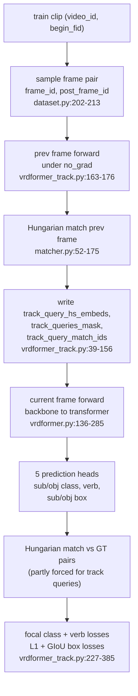
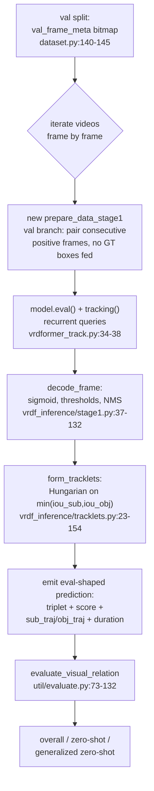

# Stage 1 — pair detection and tracking

Reference for the **stage-1** half of VRDFormer: what it trains, every parameter that changes its
behaviour, and the evaluation it does not yet have. Everything here is read from the source; every
claim carries a `file:line`.

Companions: [`STAGE2.md`](STAGE2.md) (relation classification and the implemented metrics),
[`INFERENCE.md`](INFERENCE.md) (single-video inference). Environment setup lives in
[`RUNPOD_STAGE1.md`](RUNPOD_STAGE1.md), data preparation in [`DATA.md`](DATA.md) — this document does
not repeat them.

---

## 1. What stage 1 is

Stage 1 is a DETR-style detector whose unit of prediction is not an object but an **ordered
subject–object pair**. Each of `num_queries` queries predicts, in one shot, a subject box, an object
box, a subject class, an object class, and a multi-label verb vector:

| Head | Module | Output shape | Activation |
| --- | --- | --- | --- |
| subject class | `sub_class_embed` | `[B, Q, num_obj_classes(+1)]` | softmax (CE) or sigmoid (focal) |
| object class | `obj_class_embed` | `[B, Q, num_obj_classes(+1)]` | idem |
| verb (multi-label) | `verb_class_embed` | `[B, Q, num_verb_classes]` | sigmoid |
| subject box | `sub_bbox_embed` (3-layer MLP) | `[B, Q, 4]` cxcywh | sigmoid |
| object box | `obj_bbox_embed` (3-layer MLP) | `[B, Q, 4]` cxcywh | sigmoid |

Built in `models/vrdformer.py:52-59`; the class counts are **not** taken from the CLI — they are
re-derived from the dataset name (`models/__init__.py:23-24`, see §4.1).

With `--tracking` (the default in every shipped stage-1 config) the model is
`VRDFormerTracking` (`models/vrdformer_track.py:194-197`), which prepends the previous frame's
matched queries as **recurrent track queries**, so the decoder input is
`[track queries | static queries]` (`models/transformer.py:163-176`).



---

## 2. How configuration resolves

`main.py` parses argparse, then loads `--dataset_config` and **overwrites `vars(args)` wholesale**:

```python
d = vars(args)
with open(args.dataset_config) as f:
    cfg = json.load(f)
d.update(cfg)                      # main.py:149-155
```

Consequences that matter for reproducing a run:

1. **The JSON beats the command line** for any key it contains. To change `batch_size`, `epochs`,
   `seq_len`, `pretrain`, `output_dir` or `resolution`, edit the config — a CLI flag is silently
   discarded. The wrapper scripts rely on this: they pass `--lr 5e-5 --num_queries 200` because no
   config sets those two keys. The failure mode is real and present in the repo:
   `scripts/stage1/train_vidorpart_smoke.sh` passes `--epochs 2`, but
   `configs/vidorpart_local_stage1.json` sets `"epochs": 5`, so **the run does 5 epochs**.
2. **The JSON bypasses argparse `type`/`choices`.** `--position_embedding` declares
   `choices=("sine","learned")` (`main.py:48`), yet every config sets `"sine_3d_v2"`, which is
   accepted because the value is injected after parsing. Validation of config values therefore does
   not exist.
3. **Four keys exist only in JSON**: `dataset`, `vidor_path`, `vidvrd_path`, `cautious`, `by_ratio`.
   Omitting `dataset` crashes at `models/__init__.py:23`; omitting `cautious`/`by_ratio` crashes in
   `make_video_transforms` (`datasets/vidor.py:112-116`).
4. The fully resolved namespace is written to `<output_dir>/config.json` before training
   (`main.py:173-176`) — this file, not the source JSON, is the authoritative record of a run.

---

## 3. Parameters

"Defined at" is the argparse declaration or the code site that consumes the value. "Shipped configs"
summarises `configs/*stage1*.json`; `—` means the argparse default applies.

### 3.1 Data and sampling

| Parameter | Defined at | Default | Effect | Shipped configs |
| --- | --- | --- | --- | --- |
| `dataset` | JSON only; `datasets/__init__.py:55-61`, `models/__init__.py:23-24` | — (required) | Selects the dataset class (`vidvrd` exact match, everything else → VidOR) **and** the class counts: `80/50` if `'vidor' in name`, else `35/132` | vidvrd, vidor, vidorsmall, vidorpart |
| `vidor_path` / `vidvrd_path` | JSON only; `datasets/vidor.py:95`, `datasets/vidvrd.py:74` | — | Dataset root; `assert root.exists()` aborts if wrong | absolute `/home/zhengsipeng/...` in the upstream configs, relative `data/vidorsmall` in the local ones |
| `num_workers` | `main.py:73` | `0` | DataLoader workers. `>0` also enables `timeout=300` and `persistent_workers` (`datasets/__init__.py:97-102`) | 2–16 |
| `debug` | `main.py:33` | `False` | Forces `num_workers=0` (`main.py:161`), **truncates every epoch to a single iteration** — the break fires at `i = 0` (`util/misc.py:118-119`) — skips raw-annotation loading (`datasets/dataset.py:115-116`) and the zero-shot triplet scan (`datasets/__init__.py:72`). Because `raw_annos` and `zeroshot_triplets` never exist, this also makes evaluation impossible | `true` in the two vidorpart configs |
| `train_clip_sample_ratio` | `main.py:78-80` | `1.0` | Keeps every `round(1/ratio)`-th clip, strided over the `train_begin_fids` list (`datasets/dataset.py:130-139`) | `0.005` (smoke), `0.25` (some stage-2) |
| `resolution` | `main.py:98` | `"large"` | Selects a transform preset (`datasets/dataset.py:434-448`); see §3.6 | `"large"` in the vidorsmall configs |
| `cautious` | JSON only; `datasets/dataset.py:432` | — (required) | `True` disables the horizontal flip **and** makes the random crop reject any crop that would drop a subject or object box (`datasets/video_transforms.py:481-526`) | `true` everywhere |
| `by_ratio` | JSON only; `datasets/dataset.py:462` | — (required) | Switches the crop from a pixel-size draw to an area/aspect-ratio draw (`datasets/video_transforms.py:446-479`) | `false` everywhere |
| `overflow_boxes` | `main.py:131` | `False` | In `crop`, clamp boxes into the image instead of removing boxes that fall partly outside (`datasets/video_transforms.py:385-400`) | `true` in the deformable stage-1 configs |
| `max_duration` | `main.py:96` | `24` | **Inert.** Stored on the dataset (`datasets/dataset.py:105`) and never read; clip length comes from the metadata `durations` array | 24 |
| `seq_len` | `main.py:97` | `8` | **Inert in stage 1.** `prepare_data_stage1` never reads it — stage 1 samples exactly two frames (the pair) regardless | 2 |
| `accumulate_steps` | `main.py:31` | `1.0` | Gradient accumulation; see §5 | 1 (2 for vidor deformable) |
| `batch_size` | `main.py:27` | `2` | Pairs per forward **per process**; batch sampler is `BatchSampler(..., drop_last=True)` (`datasets/__init__.py:91-92`) | 4 (2 for deformable, which omits the key) |
| `epochs` | `main.py:28` | `50` | Number of passes | 2 (vidorsmall), 5 (vidor), 7 (vidvrd) |

### 3.2 Model and transformer

| Parameter | Defined at | Default | Effect | Shipped configs |
| --- | --- | --- | --- | --- |
| `backbone` | `main.py:46` | `"resnet101"` | torchvision model name, BatchNorm frozen (`models/backbone.py:97-106`) | `resnet101`; `resnet50` for deformable |
| `hidden_dim` | `main.py:54` | `256` | Embedding width; position-encoding split is `hidden_dim//3` (3-D PE) or `//2` (2-D) (`models/position_encoding.py:219-227`) | 256; 288 deformable |
| `dim_feedforward` | `main.py:53` | `2048` | Transformer FFN width | 2048; 1024 deformable |
| `enc_layers` / `dec_layers` | `main.py:51-52` | `6` / `6` | Encoder/decoder depth. `dec_layers` also sets how many auxiliary loss weights exist (`models/__init__.py:70-75`) | 6 / 6 |
| `nheads` | `main.py:56` | `8` | Attention heads | 8 |
| `dropout` | `main.py:55` | `0.1` | Transformer dropout | 0.1 |
| `num_queries` | `main.py:57` | `100` | Static pair queries. Set to 200 by every wrapper; **not** present in any config JSON, so the CLI value survives | 200 |
| `pre_norm` | `main.py:58` | `False` | Pre-LN transformer blocks | `false` |
| `position_embedding` | `main.py:48` | `"sine"` | With `multi_frame_attention and multi_frame_encoding` → 3-D sine (`sine_3d_v2`); otherwise 2-D sine (`models/position_encoding.py:218-235`) | `sine_3d_v2`; plain `sine` for deformable stage 1 |
| `multi_frame_attention` | `main.py:132` | `False` | Encodes previous **and** current frame; **doubles** `num_feature_levels` (`models/transformer.py:440-441`) | `true` |
| `multi_frame_encoding` | `main.py:133` | `False` | Enables per-frame positional slicing and selects the 3-D encoder | `true` |
| `multi_frame_attention_separate_encoder` | `main.py:135` | `False` | Runs the encoder separately on the two frame halves and concatenates the memories (`models/transformer.py:125-135`) | `true` |
| `merge_frame_features` | `main.py:134` | `False` | Fuses prev+current backbone features with a 1×1 conv instead of stacking them | `false` everywhere |
| `num_feature_levels` | `main.py:129` | `1` | FPN levels. `>1` turns on multi-level backbone returns (`models/backbone.py:133`) and is what the 4-level deformable configs use, but **no assertion requires it** — only the non-deformable path asserts `== 1` (`main.py:163-164`), and `vidor_stage2_deform.json` runs deformable with 1 | 1; 4 for the main deformable configs |
| `deformable` | `main.py:128` | `False` | Swaps in `DeformableTransformer` (`models/__init__.py:14-19`) and requires the compiled `models/ops` extension. With `num_feature_levels: 1` it degenerates to a single level (see the row above) | deformable configs only |
| `with_box_refine` | `main.py:130` | `False` | Per-layer heads + iterative box refinement (`models/vrdformer.py:102-122`) | `true` for deformable |
| `aux_loss` | `main.py:61` (`--no_aux_loss`, `store_false`) | **`True`** | Auxiliary losses on every intermediate decoder layer. Note the default is *True*: a config must set `"aux_loss": false` to disable it | `false` in non-deformable stage 1, `true` in deformable |
| `focal_loss` | `main.py:138` | `False` | Replaces the softmax/CE head with a sigmoid focal head and **drops the no-object slot** from the model's output width (`models/__init__.py:29`) | `true` everywhere |
| `focal_alpha` / `focal_gamma` | `main.py:139-140` | `0.25` / `2` | Focal loss and focal matching cost. `focal_gamma` reaches the loss only — `build_matcher` does **not** forward it (`models/matcher.py:178-186`) | defaults |
| `dilation` | `main.py:47` | `False` | DC5: replaces the last backbone stride with dilation and halves the last stride (`models/backbone.py:100-105`) | `false` |
| `dec_n_points` / `enc_n_points` | `main.py:136-137` → `models/deformable_transformer.py:484-485` | `4` / `4` | Deformable-attention sampling points per decoder/encoder layer. **Read only when `deformable: true`** | defaults |

### 3.2b Run control and distributed

| Parameter | Defined at | Default | Effect | Shipped configs |
| --- | --- | --- | --- | --- |
| `output_dir` / `--output-dir` | `main.py:66`; JSON `output_dir` | `""` | Where `config.json`, `checkpoint*.pth` and `log.txt` go. Empty means **nothing is saved** (`main.py:174-176, 218-231`) | a `data/ckpts/...` path in every config |
| `start-epoch` | `main.py:72` | `0` | First epoch; overwritten from the checkpoint on `--resume` (`util/checkpoints.py:181`) | `0` |
| `resume` | `main.py:69` | `""` | Full continuation: model, optimizer, scheduler, epoch (`util/checkpoints.py:173-183`) | `""` (eval uses it — see [`STAGE2.md`](STAGE2.md)) |
| `resume_shift_neuron` | `main.py:70` | `False` | Only on the deformable pretrain path: shifts `class_embed` neurons so label 0 starts at neuron 0 (`util/checkpoints.py:65-74, 203`) | `false` |
| `world-size`, `dist-url` | `main.py:86-87` | `1`, `"env://"` | Distributed rendezvous. `world_size` is overwritten from `WORLD_SIZE` and `dist_url` is the `init_method` (`util/dist.py:153-180`) | `env://`; launcher supplies the rest |
| `local-rank` (`local_rank`) | `main.py:88` | `-1` | **Never read** — the launcher sets the `LOCAL_RANK` env var instead | — |
| `coco-path` (`coco_path`) | `main.py:92` | `""` | **Unreachable.** Only read by `datasets/coco.py:254`, which `build_dataset` never dispatches to | — |
| `vis_and_log_interval` | `main.py:34` | `10` | Print every N iterations; also the break period under `--debug` (`util/misc.py:93, 118-119`) | `10` |

### 3.3 Tracking

| Parameter | Defined at | Default | Effect | Shipped configs |
| --- | --- | --- | --- | --- |
| `tracking` | `main.py:116` | `False` | Chooses `VRDFormerTracking` over the plain `VRDFormer` (`models/__init__.py:53-56`). Plain `VRDFormer` has no track queries at all | `true` |
| `track_prev_frame_range` | `main.py:117` | `0` | **The only real sampling knob.** The previous frame is `randint(frame_id, frame_id + min(range, duration-1))` (`datasets/dataset.py:206-208`). With the default 0 the previous frame is the same frame | 8 (5 for deformable) |
| `track_query_false_positive_prob` | `main.py:119` | `0.1` | Quantile for how many unmatched previous predictions are injected as false track queries (`models/vrdformer_track.py:49-54`) | default |
| `track_query_false_negative_prob` | `main.py:120` | `0.4` | Random subset of matched track queries that is dropped, so the model does not over-rely on them (`models/vrdformer_track.py:63-67`) | default |
| `track_query_false_positive_eos_weight` | `main.py:121` | `True` | Removes the no-object penalty from false track queries — **only in the non-focal CE path** (`models/vrdformer_track.py:248-255`), so it is inert under `focal_loss: true` | default (inert) |
| `track_backprop_prev_frame` | `main.py:124` | `False` | If true, the previous-frame forward is not run under `no_grad` (`models/vrdformer_track.py:163-168`) | `false` |
| `track_attention` | `main.py:125` | `False` | Adds a per-layer track-attention block. **Incompatible with `num_queries != 100`**: it splits queries at a hard-coded `[:-100]` (`models/transformer.py:225-254`) | `false` |

### 3.4 Optimization

| Parameter | Defined at | Default | Effect | Shipped configs |
| --- | --- | --- | --- | --- |
| `lr` | `main.py:23` | `1e-4` | LR for every non-backbone parameter | `5e-5` (CLI) |
| `lr_backbone` | `main.py:24` | `1e-5` | Backbone LR. Also `train_backbone = lr_backbone > 0` (`models/backbone.py:132`), so **0 freezes the backbone entirely** | `1e-5` (CLI) |
| `lr_drop` | `main.py:25` | `40` | `StepLR(optimizer, lr_drop)` — step size in **epochs**, gamma fixed at 0.1 (`main.py:196`). Also the "extra checkpoint" cadence (`main.py:221`) | 4 (vidor/vidorsmall), 5 (vidvrd) |
| `weight_decay` | `main.py:26` | `1e-4` | AdamW/SGD weight decay | `1e-4` |
| `optimizer` | `main.py:29` | `"adam"` | `"sgd"` → SGD(momentum 0.9); `"adam"` **and** `"adamw"` → `AdamW` (`util/optim.py:16-21`). The default therefore already is AdamW | `adam` |
| `clip_max_norm` | `main.py:30` | `0.1` | Gradient-norm clip; `<= 0` disables | `0.1` |
| `batch_size` | see §3.1 | `2` | Pairs per process per forward | 4 |
| `accumulate_steps` | §5 | `1.0` | Loss divided by this; optimizer steps every `accumulate_steps` iterations | 1 |
| `seed` | `main.py:68` | `42` | `seed + rank` seeds Python, NumPy, torch, CUDA (`main.py:178-184`) | `42` |
| `benchmark` | `main.py:76` | `False` | `cudnn.benchmark = benchmark`, `cudnn.deterministic = not benchmark` (`main.py:185-186`). Deterministic mode is the default | `false` |
| `amp` | `main.py:74` | `False` | **Inert in stage 1** — only `train_stage2` implements autocast (`engine.py:56-58`). `train_stage1` has no AMP path | `false` |

### 3.5 Matcher costs and loss weights

| Parameter | Defined at | Default | Effect |
| --- | --- | --- | --- |
| `set_cost_sub_class` | `main.py:104` → `models/matcher.py:138` | `0.5` | Weight of the subject-class focal/softmax cost |
| `set_cost_obj_class` | `main.py:105` → `models/matcher.py:138` | `0.5` | Weight of the object-class cost |
| `set_cost_verb_class` | `main.py:106` → `models/matcher.py:138` | `1` | Weight of the balanced multi-label verb cost (`models/matcher.py:117-123`) |
| `set_cost_bbox` | `main.py:102` → `models/matcher.py:139` | `5` | Weight of the L1 box cost; the cost uses the **worse** of subject/object (`models/matcher.py:126-128`) |
| `set_cost_giou` | `main.py:103` → `models/matcher.py:140` | `2` | Weight of the GIoU cost, likewise max over the two roles |
| `set_cost_class` | `main.py:101` | `1` | **Unused.** A vestigial DETR name; the VRD matcher has separate subject/object/verb costs |
| `obj_loss_coef` | `main.py:109` → `models/__init__.py:64` | `1` | Multiplier on `loss_ce` (and all its aux copies) |
| `verb_loss_coef` | `main.py:110` | `1` | Multiplier on `loss_ce_verb` |
| `bbox_loss_coef` | `main.py:111` | `5` | Multiplier on `loss_bbox` |
| `giou_loss_coef` | `main.py:112` | `2` | Multiplier on `loss_giou` |
| `eos_coef` | `main.py:113` | `0.1` | Relative weight of the no-object class in the **non-focal** CE head (`models/vrdformer_track.py:218-220`); inert under `focal_loss: true` |

Matching itself: `scipy.optimize.linear_sum_assignment` on a cost matrix whose class terms are focal
costs (under `focal_loss`), and whose track-query rows are **forced** — a true track query gets
`-1` on its known target and `inf` everywhere else, false track queries get an all-`inf` row
(`models/matcher.py:145-169`).

### 3.6 Augmentation presets

`make_video_transforms` (`datasets/dataset.py:423-474`) exposes three presets. The `else` branch is
the default **and the fallback for any typo**, so an unrecognised value silently means `"large"`.

| `resolution` | `scales` (short side) | `max_size` | crop `resizes` | crop min side | Val `max_size` |
| --- | --- | --- | --- | --- | --- |
| `"small"` | 288, 320, 352, 384, 416, 448, 480 | 800 | 240, 300, 360 | 240 | 800 |
| `"middle"` | 384 … 640 | 1000 | 300, 400, 500 | 300 | 1000 |
| `"large"` (default) | 480, 512, …, 800 | 1333 | 400, 500, 600 | 384 | 1333 |

Train transform (`datasets/dataset.py:453-469`): `RandomSelect(p=0.5)` between
(a) a single `RandomResize(scales, max_size)` and (b) `RandomResize(resizes)` →
`RandomSizeCrop(crop, max_size, scale=[0.8,1.0], respect_boxes=cautious, by_ratio)` →
`RandomResize(scales, max_size)`; then `ToTensor` + ImageNet `Normalize`.

Val transform (`datasets/dataset.py:471-472`): `RandomResize([800], max_size)` + normalize — i.e.
shortest side 800, capped by `max_size`. Deterministic.

Two dead ends worth knowing: `RandomHorizontalFlip` is only reachable with `cautious: false`, and its
`__call__` is defined at module scope rather than in the class (`datasets/video_transforms.py:246-250`),
so enabling it would raise `TypeError`.

### 3.7 Declared but never read

Listed so no result is ever attributed to them.

| Parameter | Status |
| --- | --- |
| `schedule` | No scheduler but `StepLR` exists (`main.py:196`) |
| `fraction_warmup_steps` | No warmup |
| `ema`, `ema_decay` | No EMA implementation |
| `eval_skip` | Never read |
| `eval_mode` | Never read |
| `frozen_weights` | Never read |
| `roi_pool_type` | Never read; `"avg"` is hard-coded in the transformer (`models/transformer.py:62`) |
| `track_query_noise` | Never read |
| `track_prev_prev_frame` | Passed to and stored on the dataset, never used (`datasets/dataset.py:110`) |
| `track_prev_frame_rnd_augs` | Same (`datasets/dataset.py:109`) |
| `local-rank` | Never read (the launcher sets `LOCAL_RANK` instead) |
| `num_obj_classes`, `num_verb_classes` | Ignored — re-derived from `dataset` |
| `max_duration`, `seq_len` (stage 1) | Stored, never used in the stage-1 path |
| `set_cost_class` | Unused matcher cost |
| `cardinality` loss | Computed and logged, but absent from `weight_dict`, so it contributes no gradient |
| aux `_enc` weights | No model ever emits `enc_outputs` (`models/vrdformer_track.py:445-458` is unreachable) |
| `amp` (stage 1) | No autocast in `train_stage1` |

---

## 4. Training loop

### 4.1 Per-iteration order (`engine.py:151-240`)

| Step | What happens | Line |
| --- | --- | --- |
| 1 | `model.train()`, `criterion.train()`; meters for `lr`, `sub/obj/verb_class_error` | 156-167 |
| 2 | `optimizer.zero_grad()` once before the loop | 169 |
| 3 | Batch arrives as `(NestedTensor, list[target])`; `collate_fn` builds the nested tensor (`util/misc.py:324-327`) | 170-174 |
| 4 | `outputs, targets, *_ = model(samples, targets)` — the model **mutates** `targets` to add track-query fields, which is why targets are passed by reference | 187 |
| 5 | `loss_dict = criterion(outputs, targets)` | 190 |
| 6 | `losses = Σ_k loss_dict[k] * weight_dict[k]` over keys present in both | 191-192 |
| 7 | `reduce_dict` for logging; `is_loss_invalid` aborts **all ranks** on a non-finite loss (NaN survives the all-reduce, so every rank detects it) | 195-206 |
| 8 | `losses = losses / accumulate_steps`; `backward()` | 208-209 |
| 9 | `clip_grad_norm_(..., clip_max_norm)` — **every iteration**, before the step test | 210-211 |
| 10 | `optimizer.step(); zero_grad()` when `(i+1) % accumulate_steps == 0` | 213-215 |

**Gradient-scale note:** step 9 clips per iteration, not per optimizer step, so with
`accumulate_steps > 1` the clip acts on a partial gradient. There is also **no tail flush**: if the
epoch length is not a multiple of `accumulate_steps`, the final partial window's gradients are never
stepped, unlike stage 2 which flushes (`engine.py:132-142`).

### 4.2 Outer loop (`main.py:209-245`)

| Step | Detail | Line |
| --- | --- | --- |
| Epochs | `range(start_epoch, epochs)`; `sampler_train.set_epoch(epoch)` when distributed | 209-211 |
| Train | `train_one_epoch(...)` returns `{meter: global_avg}` | 213-214 |
| Scheduler | `StepLR.step()` **once per epoch**, after training | 216 |
| Checkpoint | `checkpoint.pth` every epoch, plus `checkpoint{epoch:04}.pth` — the `(epoch+1) % 1 == 0` condition is always true, so both are written | 218-231 |
| Payload | `{'model', 'optimizer', 'lr_scheduler', 'epoch', 'args'}` | 225-231 |
| Validation | **Stage 1 does none.** The per-epoch eval is guarded by `if args.stage == 2` | 233 |
| Log | `log.txt`, one JSON line per epoch: all `train_*` meters, `epoch`, `n_parameters` | 236-241 |

### 4.3 Loss terms

`SetCriterionTrack` (`models/vrdformer_track.py:200-460`) computes, under
`focal_loss: true`:

| Term | Formula / definition | Weight | Line |
| --- | --- | --- | --- |
| `loss_ce` | Mean of the subject and object focal classification losses over all queries matched to a GT pair; each multiplied by `num_queries` (`src_logits.shape[1]`) | `obj_loss_coef` = 1 | 270-311 |
| `loss_ce_verb` | Sigmoid focal over the multi-label verb one-hot, same `× num_queries` scaling | `verb_loss_coef` = 1 | 313-336 |
| `loss_bbox` | Mean of subject and object L1 box losses, normalised by `num_trajs` (GT pairs summed across ranks, `/world_size`, floor 1) | `bbox_loss_coef` = 5 | 356-385 |
| `loss_giou` | Mean of subject and object `1 - GIoU` | `giou_loss_coef` = 2 | 356-385 |
| `sub/obj/verb_class_error` | `100 - top-1 accuracy` / `100 - multi-label top-1 hit`, logging only | — | 258-261, 331-334 |
| `*_cardinality_error` | L1 on predicted vs GT counts, `@torch.no_grad`, logging only — **no weight_dict entry** | 0 | 338-354 |

The loss actually optimised is therefore
`1·loss_ce + 1·loss_ce_verb + 5·loss_bbox + 2·loss_giou`, plus the same four per auxiliary decoder
layer when `aux_loss` is on (suffix `_0…_4`) — which is why non-deformable stage-1 configs set
`aux_loss: false`.

---

## 5. Shipped config matrix (stage 1)

`—` means the argparse default applies. Deformable columns are the `*_stage1_deform.json` files.

| Key | vidvrd | vidor | vidorsmall | vidorpart | vidvrd deform | vidor deform |
| --- | --- | --- | --- | --- | --- | --- |
| `stage` | 1 | 1 | 1 | 1 | 1 | 1 |
| `batch_size` | 4 | 4 | 4 | 4 | — (2) | — (2) |
| `epochs` | 7 | 5 | 2 | 5 | 7 | 5 |
| `lr_drop` | 5 | 4 | 4 | 4 | 5 | 4 |
| `num_workers` | 16 | 16 | 2 | 16 | 16 | 16 |
| `seq_len` | 2 | 2 | 2 | 2 | 2 | 2 |
| `tracking` | true | true | true | true | true | true |
| `track_prev_frame_range` | 8 | 8 | 8 | 8 | 5 | 5 |
| `focal_loss` | true | true | true | true | true | true |
| `aux_loss` | false | false | false | false | true | true |
| `multi_frame_attention` | true | true | true | true | true | true |
| `multi_frame_encoding` | true | true | true | true | true | true |
| `…separate_encoder` | true | true | true | true | true | true |
| `num_feature_levels` | 1 | 1 | 1 | 1 | 4 | 4 |
| `deformable` | — | — | — | — | true | true |
| `backbone` | — r101 | — r101 | — r101 | — r101 | resnet50 | resnet50 |
| `hidden_dim` | — 256 | — 256 | — 256 | — 256 | 288 | 288 |
| `dim_feedforward` | — 2048 | — 2048 | — 2048 | — 2048 | 1024 | 1024 |
| `resolution` | — large | — large | large | — large | — large | — large |
| `train_clip_sample_ratio` | — 1.0 | — 1.0 | — 1.0 | — 1.0 (debug: true) | — | — |
| `pretrain` | `detr-r101` | `detr-r101` | `detr-r101` | `detr-r101` | deform r50 | deform r50 |
| `output_dir` | `vidvrd_deform_v2` ¹ | `vidor_detr_v2` | `vidorsmall_stage1` | `vidorpart_detr_v0` | `vidvrd_deform_v2` | `vidor_deform_v2` |

¹ The name says "deform" but `vidvrd_stage1.json` is **not** deformable — a leftover directory name.

All wrappers additionally pass, on the command line: `--lr 5e-5 --lr_backbone 1e-5 --num_queries 200
--accumulate_steps 1` (`scripts/stage1/train*.sh`). Those survive only because no config sets them.

---

## 6. Parameters used in this work

Filled from the resolved config written by the run itself
(`data/ckpts/vidorsmall_stage1/config.json`), not from the source JSON, because the two can differ.

| Setting | Value | Source |
| --- | --- | --- |
| Dataset | `vidorsmall` (VidOR subset) | resolved `config.json` |
| `num_obj_classes` / `num_verb_classes` | 80 / 50 (derived from `vidorsmall`) | `models/__init__.py:23-24` |
| `stage` | 1 | resolved |
| `batch_size` | 4 | resolved |
| `accumulate_steps` | 1 | resolved |
| `epochs` | 2 | resolved |
| `lr` / `lr_backbone` | 5e-5 / 1e-5 | resolved |
| `lr_drop` | 4 | resolved |
| `weight_decay` | 1e-4 | resolved |
| `optimizer` | `adam` → AdamW | `util/optim.py:16-21` |
| `clip_max_norm` | 0.1 | resolved |
| `num_queries` | 200 | resolved |
| `hidden_dim` / `dim_feedforward` / heads / layers | 256 / 2048 / 8 / 6+6 | resolved |
| `seq_len` | 2 | resolved |
| `resolution` | `large` | resolved |
| `tracking` / `track_prev_frame_range` | true / 8 | resolved |
| `focal_loss` / `aux_loss` | true / false | resolved |
| `multi_frame_attention` / `_encoding` / `_separate_encoder` | true / true / true | resolved |
| `num_feature_levels` / `deformable` | 1 / false | resolved |
| `amp` | false (inert in stage 1) | resolved |
| `benchmark` | false (deterministic) | resolved |
| `train_clip_sample_ratio` | 1.0 | resolved |
| `seed` | 42 | resolved |
| Trainable parameters | 60.48 M | `log.txt` (`n_parameters`) |
| GPUs / launcher | `--nproc_per_node=${NPROC_PER_NODE:-1}` | `scripts/stage1/train_vidorsmall.sh` |
| Checkpoint used downstream | `data/ckpts/vidorsmall_stage1/checkpoint0001.pth` (epoch 1) | verified by loading it |

### 6.1 Training log from this run

`data/ckpts/vidorsmall_stage1/log.txt`, one line per epoch. These are **training** losses, not
evaluation metrics — stage 1 has no validation pass.

| Epoch | loss | loss_ce | loss_ce_verb | loss_bbox | loss_giou | sub_class_error | obj_class_error | verb_class_error |
| --- | --- | --- | --- | --- | --- | --- | --- | --- |
| 0 | 4.5513 | 0.6275 | 0.6162 | 1.8416 | 1.4660 | 72.71 | 72.14 | 56.45 |
| 1 | 3.2557 | 0.5133 | 0.5425 | 1.1368 | 1.0631 | 58.94 | 59.84 | 48.92 |

`*_class_error` is `100 - top-1 accuracy`, so the last epoch's subject class is correct for ~41 % of
matched queries. It measures fit on the training set only.

---

## 7. Evaluation

### 7.1 Status: none exists

Stage 1 trains but is never evaluated. Three code sites are decisive:

| Evidence | Line |
| --- | --- |
| Only `train_stage1` is imported when `stage == 1`; `eval_one_epoch` is never bound | `main.py:167-171` |
| `--eval` asserts `stage == 2` | `main.py:200-201` |
| The per-epoch eval call is guarded by `if args.stage == 2` | `main.py:233` |

The only eval-adjacent code inside `train_stage1` is a commented-out visualisation block
(`engine.py:223-234`) that calls `make_results` / `postprocessors` / `vis_results` — **none of which
exist anywhere in the repository**.

The val dataset cannot be iterated either. `prepare_data_stage1` reads
`self.train_begin_fids` (`datasets/dataset.py:203`), but that attribute is assigned **only** in the
`image_set == "train"` branch (`datasets/dataset.py:128-139`). Verified:

```
$ ds = VidOR('vidorsmall', 'val', ..., stage=1, ...); len(ds)   # 104
$ ds[0]
AttributeError: 'VidOR' object has no attribute 'train_begin_fids'
```

Finally, `TrackingBase.tracking()` — the switch that would put the model into inference-tracking
mode — exists (`models/vrdformer_track.py:34-38`) and is **never called**.

### 7.2 Proposed metrics

The upstream VidVRD/VidOR task defines two families, and the existing evaluator already implements
both; a stage-1 evaluator only has to feed them the right structures.

| Metric | Definition | Matching rule | Reuses |
| --- | --- | --- | --- |
| **Box AP@0.5** (subject, object) | Per-video AP of per-frame box detections against GT boxes, IoU ≥ 0.5 | Greedy best-overlap, one GT matched once | `util/compute.voc_ap` (`util/compute.py:42-75`); no existing matcher — must be written |
| **Pair AP@0.5** | Same, but a pair counts as correct only if **both** boxes clear IoU 0.5 — equivalently `min(iou_sub, iou_obj) ≥ 0.5` | as above, per `(sub_cls, obj_cls)` | same |
| **Detection mean AP (mAP@50)** | Per video: sort predictions by score, greedy-match to GT with volumetric IoU ≥ 0.5, `voc_ap` on that video's PR curve; then **macro-average over videos** | exact `(subject, predicate, object)` string equality **and** vIoU ≥ 0.5 | `util/evaluate.eval_detection_scores` (`:32-70`), `voc_ap` |
| **Detection recall@50 / @100** | Per video keep the top-N predictions, pool all videos, sort globally by score; recall = matched GT / total GT | as above | `util/evaluate.py:104-107, :119-126` |
| **Tagging precision@1 / @5 / @10** | Dedup predicted triplets by name, rank by score, precision of the first k; mean over videos. Ignores all boxes and time | triplet set membership only | `util/evaluate.eval_tagging_scores` (`:6-29`) |
| **Tracking identity (optional)** | MOTA / IDF1 over track ids | IoU ≥ 0.5 per frame + Hungarian | **not implemented anywhere**; `lap` is installed but unused |

Two precision points, because they are easy to get wrong in a write-up:

- **"mAP@50" in this codebase means vIoU ≥ 0.5, not box IoU ≥ 0.5.** The volumetric IoU
  (`util/compute.viou`, `util/compute.py:78-119`) sums per-frame intersection areas over the temporal
  intersection and divides by the union of the **full** trajectory volumes. A pair whose boxes are
  perfect but whose time span is disjoint scores **0**.
- The 0.5 threshold is a **function default** (`util/evaluate.py:73-75`). The convenience wrapper
  `evaluate()` calls `evaluate_visual_relation` with no overrides (`:138, :170, :172`), so to vary the
  threshold — e.g. report mAP@30 as well — a stage-1 evaluator must call
  `evaluate_visual_relation(gt, pred, viou_threshold=0.3)` directly.

For reference, `vitou` and `voc_ap` are already load-bearing in stage 2, so a stage-1 evaluator would
inherit tested code for the two hardest pieces.

### 7.3 How to implement it

Design only — nothing below is implemented.



| Hook | File today | What must change |
| --- | --- | --- |
| Val iteration | `datasets/dataset.py:202-213` | Add an `image_set == "val"` branch that walks `val_frame_meta` (all positive frames per video) and returns consecutive frame pairs; the current code reads `train_begin_fids`, which does not exist for val. Keep targets — the evaluator needs GT ids, but **not** GT boxes as query initialization (that would make it stage 2) |
| Inference-tracking mode | `models/vrdformer_track.py:34-38` | Call `tracking()`; today the eval branch zeroes all track queries and evaluates detection only (`models/vrdformer_track.py:177-187`) |
| Detection decoding | `vrdf_inference/stage1.py:37-132` | Reusable as-is: sigmoid decode, thresholds, `pair_score = min`, NMS on `min(iou_sub, iou_obj)` |
| Association | `vrdf_inference/tracklets.py:23-154` | Reusable as-is |
| Prediction shape | `vrdf_inference/results.py:141-189` | Reusable as-is — `write_eval_prediction` already emits `{triplet, score, sub_traj, obj_traj, duration}` |
| Driver | `engine.py:243-290` | New `eval_stage1` + `main.py` dispatch (`main.py:167-171`, `:200-203`, `:233`) |
| Metric call | `util/evaluate.py:73-132` | Direct call with `viou_threshold` if a non-default threshold is wanted |

Four constraints that will bite:

1. **Coordinate space.** GT trajectories are `[0,1]`-normalized (`datasets/dataset.py:290-296`);
   inference predicts source-pixel xyxy. `viou` compares them without rescaling, so one side must be
   converted. This is already flagged in `vrdf_inference/results.py:161-166`.
2. **Frame-id alignment.** `viou` indexes `traj[k]` as frame `duration[0] + k`
   (`util/compute.py:105-107`). Annotation durations count source frames; a strided run's decoded
   indices are not the same axis. Evaluate at stride 1 on the original videos, or align explicitly.
3. **`--debug` makes eval impossible** twice over: `zeroshot_triplets` is never created (→
   `AttributeError` in `util/evaluate.py:155`) and `raw_annos` is never loaded (→ `KeyError` in
   `get_relation_insts`).
4. **Detection AP is skipped for any video whose predictions lack `sub_traj`.** A single prediction
   without trajectories disables the metric for the entire run (`util/evaluate.py:98`, keyed on
   `predict_relations[0]`).

The cleanest minimal implementation is: an `eval_stage1` that reuses `run_detection` +
`form_tracklets` over each val video at stride 1, builds predictions in the
`write_eval_prediction` shape with **GT-derived** durations only if you want an oracle-time variant,
and calls `evaluate_visual_relation`. Report box AP and pair AP separately, since triplet mAP
conflates detection with the verb head — and note that the stage-1 verb head is not the one stage 2
uses at inference.

### 7.4 Results

<!-- TODO: fill from your run of the evaluator described in 7.3 -->

| Setting | Box AP@50 (sub) | Box AP@50 (obj) | Pair AP@50 | Detection mAP@50 | R@50 | R@100 | Tagging P@1 | P@5 | P@10 |
| --- | --- | --- | --- | --- | --- | --- | --- | --- | --- |
| overall | TODO | TODO | TODO | TODO | TODO | TODO | TODO | TODO | TODO |
| zero-shot | — | — | — | TODO | TODO | TODO | TODO | TODO | TODO |
| generalized zero-shot | — | — | — | TODO | TODO | TODO | TODO | TODO | TODO |

The only stage-1 numbers in the repository today are **training** losses (§6.1) and an ad-hoc
localisation measurement quoted in `docs/RUNPOD_INFERENCE.md:285-286` (box recall 0.41 @IoU 0.50,
0.59 @IoU 0.30, 0.25 with the correct class) — no script reproducing it survives.

---

## 8. Known rough edges

| Issue | Detail | Line |
| --- | --- | --- |
| No tail flush | `accumulate_steps > 1` silently drops the last partial window's gradients | `engine.py:213-215` |
| Per-iteration clipping | Gradient clipping runs on partial accumulated gradients | `engine.py:210-211` |
| `track_attention` + 200 queries | Hard-coded `[:-100]` query split | `models/transformer.py:225-254` |
| Deformable is CUDA-only | `prepare_tag_query` / `extract_roi_feat` call `.cuda()` unconditionally | `models/deformable_transformer.py:84-97` |
| `aux_loss` default is `True` | A config that omits it gets auxiliary losses; the shipped non-deformable configs explicitly disable it | `main.py:61` |
| `resolution` fallback | Any unrecognised value silently selects `"large"` | `datasets/dataset.py:434-448` |
| Duplicate checkpoints | Both `checkpoint.pth` and `checkpoint{epoch}.pth` are written every epoch | `main.py:219-222` |
| Eval absent | See §7 | — |
