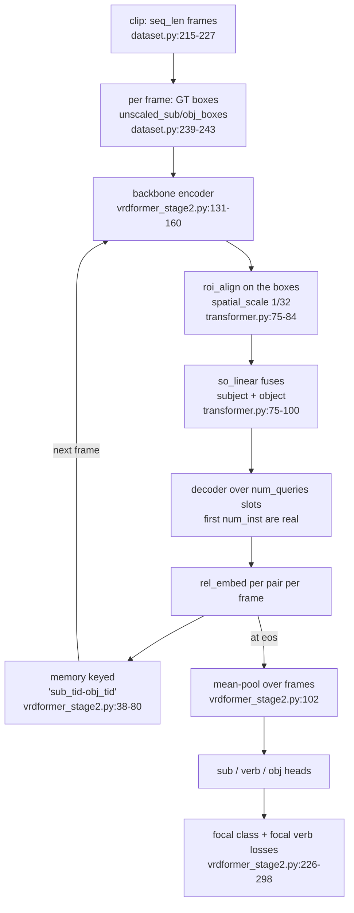

# Stage 2 — relation classification over time, and the implemented metrics

Reference for the **stage-2** half of VRDFormer: what it trains, every parameter that changes its
behaviour, and — unlike stage 1 — the evaluation that actually exists, metric by metric. Every claim
carries a `file:line`.

Companions: [`STAGE1.md`](STAGE1.md) (pair detection, tracking, and the missing stage-1 evaluation),
[`INFERENCE.md`](INFERENCE.md) (single-video inference). Environment setup is in
[`RUNPOD_STAGE2.md`](RUNPOD_STAGE2.md).

---

## 1. What stage 2 is

Stage 2 is a **relation classifier over ground-truth-initialized pairs**. It does not detect objects
and does not enumerate candidate pairs. For each frame it is handed subject/object boxes, and it

1. pools encoder features inside those boxes with `roi_align` (`models/transformer.py:75-84`),
2. fuses the two pooled vectors into one query embedding with `so_linear`
   (`models/transformer.py:143-148`),
3. runs a padded decoder over `num_queries` slots, only the first `num_inst` of which are real
   (`models/transformer.py:86-100`),
4. appends that frame's per-pair `rel_embed` to a `memory` dict keyed by `"<sub_tid>-<obj_tid>"`,
5. at end-of-sequence, **mean-pools each pair's embeddings over all its frames** and applies three
   heads: subject class, verb (multi-label), object class
   (`models/vrdformer_stage2.py:97-116`).



The consequence that governs everything in §7: **the pair set and the time spans are given, not
predicted.** Stage 2 supplies a verb for each ground-truth pair.

---

## 2. How configuration resolves

Identical to stage 1 — `--dataset_config` overwrites `vars(args)` wholesale (`main.py:149-155`), so
the JSON beats the command line. The stage-1 document covers the details; the stage-2-specific
consequences are:

- `pretrain` must point at a **stage-1** checkpoint, loaded through `resume_stage2`
  (`util/checkpoints.py:159-170, 197-205`). Loading stage-1 weights into a stage-2 model is the
  intended flow; `--resume` is for continuing stage-2 training or evaluating it.
- Because `resume_stage2` **half-slices** any tensor whose shape differs, `num_queries` must match
  the stage-1 checkpoint exactly. A checkpoint stores `query_embed.weight` shaped `(200, 512)`;
  building the model with `num_queries=100` produces a size mismatch that `strict=False` does **not**
  rescue. This is why both vidorsmall configs omit `num_queries` and the wrappers pass `200`.

---

## 3. Parameters

Only the keys whose stage-2 behaviour differs from stage 1, plus the stage-2-only ones. Shared
parameters (`lr`, `lr_drop`, `weight_decay`, `optimizer`, `clip_max_norm`, `seed`, the matcher costs,
`focal_*`, `hidden_dim`, `enc_layers`, `dec_layers`, `nheads`, `dropout`, `backbone`,
`num_feature_levels`) behave as documented in [`STAGE1.md` §3](STAGE1.md#3-parameters); the matcher
costs are in fact **unused in stage 2** because no matcher is built.

### 3.1 Stage-2-specific parameters

| Parameter | Defined at | Default | Effect | Shipped configs |
| --- | --- | --- | --- | --- |
| `stage` | `main.py:91` | `2` | Selects the dataset `__getitem__`, the model class, the criterion **and** the training loop (`main.py:167-171`, `models/__init__.py:58-62`) | 2 |
| `seq_len` | `main.py:97` | `8` | **Real here.** Frames sampled per training clip (`datasets/dataset.py:222-225`) and the number of frame steps per optimizer iteration (`engine.py:77`) | 8 |
| `batch_size` | `main.py:27` | `2` | Clips per forward. Stage 2 keeps the autograd graph across all `seq_len` frames, so peak memory scales with `batch_size × seq_len` | 1 (4 in the kaggle config) |
| `amp` | `main.py:74` | `False` | **Real here.** `bf16` on Ampere+ (no loss scaling), else `fp16` with `GradScaler` (`engine.py:56-58`); wraps the whole frame loop in `autocast` (`engine.py:76`) | true in the vidorsmall/kaggle/runpod configs |
| `train_clip_sample_ratio` | `main.py:78-80` | `1.0` | Keep every `round(1/ratio)`-th training clip (`datasets/dataset.py:130-139`) | 0.25 |
| `pretrain` | `main.py:71` | `""` | Stage-1 checkpoint to initialize from, via `resume_stage2` | `…/vidorsmall_stage1/checkpoint0001.pth` |
| `resolution` | `main.py:98` | `"large"` | Val transform and thus the `roi_align` scale the weights expect. **The dominant throughput knob**: `"small"` is ~2.8× faster than `"large"` on VidOR-native sizes | `large` in the JSON, but the stored checkpoint says `small` — see §3.3 |
| `benchmark` | `main.py:76` | `False` | cudnn autotune. Keep off when the input size is randomized every iteration | false |
| `num_queries` | `main.py:57` | `100` | Decoder slots; only `num_inst ≤ num_queries` are used per frame (`models/transformer.py:86-100`). Must match the stage-1 checkpoint | 200 (CLI) |
| `multi_frame_attention` | `main.py:132` | `False` | Off in all stage-2 configs except one deformable; the transformer takes the dedicated `stage == 2` branch regardless (`models/transformer.py:139-160`) | false |
| `multi_frame_encoding` | `main.py:133` | `False` | Selects 3-D vs 2-D positional encoding; with `multi_frame_attention: false` the 2-D path is used | false |
| `multi_frame_attention_separate_encoder` | `main.py:135` | `False` | Only meaningful with multi-frame attention | false |
| `aux_loss` | `main.py:61` | **`True`** | Accepted but **has no effect**: `VRDFormer_S2.forward` never emits `aux_outputs`, and `SetCriterion.forward` ignores them (`models/vrdformer_stage2.py:308-313`) | omitted → `true`, harmlessly |
| `focal_loss` | `main.py:138` | `False` | Sigmoid focal heads and no no-object slot | true |
| `focal_alpha` / `focal_gamma` | `main.py:139-140` | `0.25` / `2` | Used by the stage-2 focal losses | defaults |
| `tracking` | `main.py:116` | `False` | Should be `false`; stage 2 has no track queries. Inference forces it to `false` explicitly (`vrdf_inference/checkpoints.py:61`) | absent |
| `max_duration` | `main.py:96` | `24` | **Inert** — clip length comes from the metadata `durations` array | 24 |

### 3.2 Loss configuration

| Term | Weight | Source |
| --- | --- | --- |
| `loss_ce` | `obj_loss_coef` = 1 | `models/__init__.py:64` |
| `loss_ce_verb` | `verb_loss_coef` = 1 | `models/__init__.py:65` |
| `loss_bbox`, `loss_giou` | present in `weight_dict` (5, 2) but **never produced** by the stage-2 criterion, so they never match | `models/vrdformer_stage2.py:300-306` |
| `eos_coef` | unused: `empty_weight` is registered and never read | `models/vrdformer_stage2.py:218-220` |
| matcher costs | unused: `build_model` passes `matcher=None` for stage 2 | `models/__init__.py:21` |

### 3.3 Resolution: config vs checkpoint

The stored stage-2 checkpoint's saved args say `resolution = "small"`; the current
`configs/vidorsmall_stage2.json` says `"large"` (it was changed in commit `b833e60` *after* the
checkpoint was trained). Training reads only the JSON, so a retrain would use `large`. Inference
resolves `resolution` in the checkpoint's favour (`vrdf_inference/cli.py:53, 255-256`), so the
existing checkpoint runs at `small`. Both facts are relevant to a results section: **state which
resolution each reported number came from.**

### 3.4 Declared but never read (stage 2 view)

All of §3.7 in [`STAGE1.md`](STAGE1.md#37-declared-but-never-read) applies, plus the stage-2-specific
inert items: `aux_loss` (no aux outputs), `loss_bbox`/`loss_giou` weights (no such losses),
`eos_coef`, all `set_cost_*` (no matcher), `tracking` and every `track_*` key.

---

## 4. Training loop

### 4.1 Per-iteration order (`engine.py:38-148`)

| Step | What happens | Line |
| --- | --- | --- |
| 1 | `model.train()`, `criterion.train()`; meters as in stage 1 | 39-50 |
| 2 | `optimizer.zero_grad()` before the loop | 52 |
| 3 | Choose AMP dtype: `bf16` if `amp and torch.cuda.is_bf16_supported()`, else `fp16`; `GradScaler` enabled only for `fp16` | 56-58 |
| 4 | Batch arrives as a `(b, t, c, h, w)` nested tensor plus a **list of per-clip target lists**; `NestedTensor.from_tensor_list` handles the 4-D branch (`util/misc.py:257-266`) | 64-69 |
| 5 | **Frame loop** `for fid in range(seq_len)`: `samples.select_frame(fid)` → `model(cur_frame, frame_targets, memory, eos=(fid+1)==seq_len)` | 77-84 |
| 6 | Per-clip criterion on the accumulated memory, then **summed across the batch**: `{k: Σ_b d[k]}`. Summing preserves the `batch_size = 1` gradient scale | 86-88 |
| 7 | Weighted sum over `weight_dict` | 90-92 |
| 8 | `reduce_dict` (logging), `is_loss_invalid` group abort | 95-106 |
| 9 | `losses / accumulate_steps`; `scaler.scale(...).backward()` or plain `backward()` | 108-112 |
| 10 | At step boundaries: `unscale_` → clip → `scaler.step`/`update` → `zero_grad` | 113-123 |
| 11 | **Tail flush**: leftover gradients from a partial accumulation window are stepped after the loop | 132-142 |

Differences from stage 1 worth calling out in a write-up:

- **AMP exists only here.** Stage 1 has no autocast path.
- **Clipping happens at optimizer-step boundaries** (after `unscale_`), whereas stage 1 clips every
  iteration on partial gradients.
- **The tail is flushed**, so `accumulate_steps` never silently discards work.
- **Nothing is detached between frames in training** (`models/vrdformer_stage2.py:60-62, 72-74`), so
  peak memory is proportional to `batch_size × seq_len`. That is why the vidorsmall config uses
  `batch_size: 1` and recovers an effective batch of ~4 through gradient accumulation
  (`scripts/stage2/train_vidorsmall.sh:9-21`: `NPROC=1→4`, `2→2`, `≥4→1`).

### 4.2 Outer loop

Same as stage 1 (`main.py:209-245`), with one addition: **stage 2 evaluates after every epoch**
(`main.py:233-235`) and prints the metric dict. It does not append it to `log.txt`.

### 4.3 Loss terms

`SetCriterion` in `models/vrdformer_stage2.py:197-313`:

| Term | Definition | Line |
| --- | --- | --- |
| `loss_ce` | Mean of subject and object focal classification over **all pair queries**; one-hot width `C+1`, last slot stripped; `num_trajs = src_logits.shape[0]`; multiplied by `shape[0]` | 249-278 |
| `loss_ce_verb` | Sigmoid focal on the multi-label verb target, same scaling | 281-298 |
| `sub/obj/verb_class_error` | `100 - top-1 accuracy` / multi-label hit, logging only | 237-239, 269-272, 295-297 |

Non-focal variants exist (`loss_labels`, `models/vrdformer_stage2.py:226-247`) but every shipped
config uses `focal_loss: true`, so the focal path is the one exercised.

---

## 5. Shipped config matrix (stage 2)

| Key | vidvrd | vidor | vidorsmall | vidor kaggle | vidor runpod | vidvrd deform | vidor deform |
| --- | --- | --- | --- | --- | --- | --- | --- |
| `stage` | 2 | 2 | 2 | 2 | 2 | 2 | 2 |
| `batch_size` | 1 | 1 | 1 | 4 | 1 | 1 | 1 |
| `epochs` | 3 | 2 | 2 | 1 | 2 | 3 | 2 |
| `lr_drop` | 2 | 1 | 1 | 1 | 1 | 2 | 1 |
| `seq_len` | 8 | 8 | 8 | 8 | 8 | 8 | 8 |
| `num_workers` | 16 | 16 | 0 | 2 | 4 | 0 | 16 |
| `amp` | — false | — false | true | true | true | — false | — false |
| `benchmark` | — false | — false | false | true | true | — false | — false |
| `train_clip_sample_ratio` | — 1.0 | — 1.0 | 0.25 | 0.25 | 0.25 | — 1.0 | — 1.0 |
| `resolution` | — large | — large | large ¹ | — large | — large | — large | — large |
| `multi_frame_attention` | false | false | false | false | false | true | false |
| `multi_frame_encoding` | false | false | false | false | false | false | false |
| `multi_frame_attention_separate_encoder` | false | false | false | false | false | true | false |
| `num_feature_levels` | 1 | 1 | 1 | 1 | 1 | 4 | 1 |
| `deformable` | — | — | — | — | — | true | true |
| `focal_loss` | true | true | true | true | true | true | true |
| `pretrain` | `vidvrd_detr_v2/checkpoint0006` ² | `vidor_detr_v2/checkpoint0004` | `vidorsmall_stage1/checkpoint0001` | `vidor_stage1/checkpoint0000` | `vidor_stage1/checkpoint0000` | `vidvrd_deform_v2/checkpoint0000` | `vidor_deform_v2/checkpoint0004` |
| `output_dir` | `vidvrd_detr_v2_stage2` | `vidor_detr_v2_stage2` | `vidorsmall_stage2` | `vidor_stage2` | `vidor_runpod_stage2` | `vidvrd_deform_v2_stage2` | `vidor_deform_v2_stage2` |

¹ The JSON says `large`; the trained checkpoint reports `small` (§3.3).
² `vidvrd_stage1.json` writes to `vidvrd_deform_v2`, so the stage-1 → stage-2 path for VidVRD is
internally inconsistent upstream.

---

## 6. Parameters used in this work

Filled from `data/ckpts/vidorsmall_stage2/config.json` (the run's resolved namespace) and verified
against `data/ckpts/vidorsmall_stage2/checkpoint.pth`'s saved args.

| Setting | Value | Source |
| --- | --- | --- |
| Dataset | `vidorsmall` (80 object classes, 50 verbs) | resolved |
| `stage` | 2 | resolved |
| `pretrain` | `data/ckpts/vidorsmall_stage1/checkpoint0001.pth` | resolved |
| `batch_size` | 1 | resolved |
| `accumulate_steps` | 1 (this run; the wrapper derives `max(1, 4/NPROC)`) | resolved + `scripts/stage2/train_vidorsmall.sh` |
| `epochs` | 2 | resolved |
| `lr` / `lr_backbone` | 5e-5 / 1e-5 | resolved |
| `lr_drop` | 1 | resolved |
| `weight_decay` | 1e-4 | resolved |
| `optimizer` | `adam` → AdamW | `util/optim.py:16-21` |
| `clip_max_norm` | 0.1 | resolved |
| `seq_len` | 8 | resolved |
| `num_queries` | 200 | resolved |
| `resolution` | **`small`** (checkpoint) vs `large` (config) | checkpoint args |
| `train_clip_sample_ratio` | 0.25 | resolved |
| `amp` | true (bf16 on Ampere+) | resolved |
| `benchmark` | false (deterministic) | resolved |
| `focal_loss` / `aux_loss` | true / true (aux inert) | resolved |
| `multi_frame_attention` / `_encoding` / `_separate_encoder` | false / false / false | resolved |
| `num_feature_levels` / `deformable` | 1 / false | resolved |
| `num_workers` | 0 | resolved |
| `seed` | 42 | resolved |
| Trainable parameters | 60.48 M (stage-1 figure; the stage-2 model shares the architecture) | `log.txt` of stage 1 |
| Checkpoint evaluated | `data/ckpts/vidorsmall_stage2/checkpoint.pth` — **epoch 0** (only `checkpoint0000.pth` exists) | verified by loading it |
| Distributed | `world_size 4`, `distributed true` in the resolved namespace; the eval wrapper uses `nproc_per_node=1` | resolved + `scripts/stage2/eval_vidorsmall.sh` |

> The stage-2 run left **no `log.txt`** in `data/ckpts/vidorsmall_stage2/`, so there is no recorded
> per-epoch loss for it. `checkpoint.pth` and `checkpoint0000.pth` are both epoch 0, i.e. the run
> stopped after the first epoch although `epochs: 2`.

---

## 7. Evaluation and metrics

This is the only evaluation path in the repository.

### 7.1 Flow (`engine.eval_stage2`, `engine.py:243-290`)

| Step | What happens | Line |
| --- | --- | --- |
| 1 | `model.eval()` | 244 |
| 2 | Read `data/<dataset>/action.txt` **relative to the current working directory** — run from the repo root or this fails | 251-253 |
| 3 | Val loader is the one built by `dataloader_initializer`: **batch size 1**, `SequentialSampler`, one video per item (`datasets/__init__.py:109-114`) | 254 |
| 4 | Unwrap `targets[0]` → the list of per-frame target dicts; `video_id` from the first frame | 264-265 |
| 5 | Ground truth for the video = `get_relation_insts(video_id)`, i.e. triplets **with trajectories and durations** | 267 |
| 6 | Frame ids = every frame where the val bitmap is 1 (`datasets/dataset.py:232-234`) | 268 |
| 7 | Frame loop with `is_eval=True`, `eos` on the last frame; autocast if `--amp` | 270-279 |
| 8 | `relation_classifier(memory[0], gt=groundtruth, is_eval=True)` → per-GT-relation verb index and score | 280-281 |
| 9 | Build predictions: triplet = `(gt_subject_name, predicted_verb_name, gt_object_name)`, score = the model's score | 282-286 |
| 10 | `evaluate(groundtruth, prediction, val_dataset)`; print | 288-290 |

**The oracle property.** Step 8 loops over `gt` only (`models/vrdformer_stage2.py:83-95`): one
prediction per ground-truth relation, using the GT `(subject_tid, object_tid)` pair and the GT
duration frames. There is no candidate enumeration, no score threshold, no top-k, no NMS. Whatever
the metric reports is therefore "given the right pair at the right time, did the model name the
predicate correctly, and how confidently this instance ranked".

Also note the score is a **raw logit** — `verb_logits.max().item()`, not a sigmoid
(`models/vrdformer_stage2.py:92`). Any threshold on eval scores must be calibrated on that scale.

### 7.2 Metric definitions

All three families live in `util/evaluate.py` (a vendored copy of the official VidVRD/VidOR
evaluator) and `util/compute.py`.

| Metric | Formula | Matching rule | Aggregation | Code |
| --- | --- | --- | --- | --- |
| `detection mean AP` | Per video: sort predictions by `score` desc, greedy-match to GT, `voc_ap(rec, prec)` on that video's PR curve; then **arithmetic mean over videos** | exact `(subject, predicate, object)` string equality **and** volumetric IoU ≥ 0.5, where `ov = min(sub_vIoU, obj_vIoU)`; each GT matched at most once; best-overlap candidate chosen | per-video, then macro mean | `util/evaluate.py:100-102, 116-117`; `util/compute.py:42-75` |
| `detection recall@50` | Per video keep the top-50 predictions by score, pool across videos, sort globally; `matched_GT / total_GT` | same | per-video truncation, then global pool; reported value is `rec[-1]` | `util/evaluate.py:104-107, 119-126` |
| `detection recall@100` | Same with N = 100 | same | same | same |
| `tagging precision@1` | Dedup predicted triplets by name (keep max score), rank by score, cumulative precision at rank 1; mean over videos | triplet set membership only — **no boxes, no time** | per-video, then macro mean | `util/evaluate.py:6-29, 110-112, 129-130` |
| `tagging precision@5` | cumulative precision at rank 5 | as above | as above | same |
| `tagging precision@10` | cumulative precision at rank 10 (padded to at least 10 slots) | as above | as above | same |

Defaults: `viou_threshold = 0.5`, `det_nreturns = [50, 100]`, `tag_nreturns = [1, 5, 10]`,
`allow_misalign = False` (`util/evaluate.py:73-75`). `evaluate()` never overrides them.

Two properties that are easy to misstate:

- **"mAP@50" means vIoU ≥ 0.5, not box IoU.** `viou` sums per-frame intersection areas over the
  temporal intersection and divides by the union of the **full** trajectory volumes
  (`util/compute.py:78-119`). Perfect boxes with a disjoint time span score 0.
- **Aggregations differ.** Detection AP and tagging precision are macro-averaged over videos;
  detection recall is a single global pool. The three numbers are not directly comparable.

### 7.3 What the shipped stage-2 eval actually prints

**Only the tagging row.** `evaluate_visual_relation` enters its detection branch solely when
`'sub_traj' in predict_relations[0]` (`util/evaluate.py:98`), and `engine.eval_stage2` emits
predictions with just `triplet` and `score` (`engine.py:282-286`). Verified by running the evaluator
on synthetic stage-2-shaped predictions:

```
no-traj   -> {'tagging precision@1': 1.0, 'tagging precision@5': 0.2, 'tagging precision@10': 0.1}
with-traj -> {'detection mean AP': 1.0, 'detection recall@50': 1.0, 'detection recall@100': 1.0,
              'tagging precision@1': 1.0, 'tagging precision@5': 0.2, 'tagging precision@10': 0.1}
```

So a printed stage-2 result of three tagging numbers is expected behaviour, not a bug — but a
write-up must not describe those three numbers as "detection mAP". To obtain detection mAP from this
stage, each prediction needs `sub_traj`, `obj_traj` and `duration`; the ready-made shape is
`vrdf_inference/results.py:141-189`, and the caveats are §7.6.

### 7.4 The three settings

`evaluate()` runs the same metric functions three times (`util/evaluate.py:135-174`):

| Setting | Ground truth | Predictions | Line |
| --- | --- | --- | --- |
| `overall` | the full per-video GT | all predictions | 138 |
| `zero-shot` | only relations whose triplet is in `zeroshot_triplets`; videos without any are dropped | predictions **filtered** to zero-shot triplets | 144-158, 172 |
| `generalized zero-shot` | same zero-shot GT | predictions **unfiltered** — non-zero-shot triplets may compete | 142, 159-162, 170 |

`zeroshot_triplets` is built as **val triplets minus train triplets**
(`datasets/__init__.py:72-81`), wrapped in a `try/except` that falls back to an **empty set** on
failure — in which case both zero-shot settings silently report on nothing. Building it loads and
scans the full train annotation set, which is why val-loader startup takes minutes.

Videos are skipped from a setting when they have no GT relations or no prediction entry
(`util/evaluate.py:91-94`, `:149-151`), so partial prediction coverage silently inflates the score.

### 7.5 Interpretation notes

| Property | Consequence |
| --- | --- |
| Oracle pairs and durations | Metrics measure **predicate classification**, not end-to-end relation detection |
| No threshold / top-k | Every GT pair yields exactly one prediction; precision is governed by the ranking, not by a cutoff |
| Score is a raw logit | Do not compare it to inference's sigmoid `score` field |
| No `torch.no_grad()` around the eval forward (`engine.py:271-281`) | Memory, not correctness; only the memory embeddings are detached (`models/vrdformer_stage2.py:56-58`) |
| Eval results are **printed only** | `log.txt` contains train meters, `epoch`, `n_parameters` — no eval (`main.py:236-241`). Capture stdout |
| DDP eval is sharded and unreduced | Each rank evaluates its sampler shard; only rank 0 prints (`util/dist.py:133-146`). Evaluate with `nproc_per_node=1` |
| `--eval --debug` cannot complete | `zeroshot_triplets` is never created → `AttributeError` (`util/evaluate.py:155`); `raw_annos` is never loaded → `KeyError` |
| `--eval` with `--pretrain` | Loads stage-1 weights through `resume_stage2(strict=False)` and yields meaningless numbers |
| `.index(gt_tid)` on `frame_ids` | A GT duration frame that the val bitmap excluded raises `ValueError` (`models/vrdformer_stage2.py:88`) |

### 7.6 Getting detection mAP out of stage 2

Design note, not implemented. Add to the prediction dict in `engine.py:282-286`:

- `sub_traj` / `obj_traj` — the GT trajectories for that relation. `get_relation_insts` already
  returns them (`datasets/dataset.py:401-405`), so this is a straight copy.
- `duration` — the GT `(begin_fid, end_fid)`.

Then the detection branch runs and all six metrics appear. Because both sides would come from the
same GT trajectories, detecton AP would be ~1.0 by construction — the honest variant is to substitute
**predicted** tracks (from a stage-1-plus-association pass, e.g. `vrdf_inference/tracklets.py`) while
keeping the GT verb, which measures localisation quality separately from classification. That is
precisely the gap [`STAGE1.md` §7](STAGE1.md#7-evaluation) designs an evaluator for.

### 7.7 Results

<!-- TODO: fill from your run of scripts/stage2/eval_vidorsmall.sh -->

| Setting | Detection mAP@50 | R@50 | R@100 | Tagging P@1 | P@5 | P@10 |
| --- | --- | --- | --- | --- | --- | --- |
| overall | not emitted ¹ | not emitted ¹ | not emitted ¹ | TODO | TODO | TODO |
| zero-shot | not emitted ¹ | not emitted ¹ | not emitted ¹ | TODO | TODO | TODO |
| generalized zero-shot | not emitted ¹ | not emitted ¹ | not emitted ¹ | TODO | TODO | TODO |

¹ The detection columns stay blank until §7.6 is implemented — the shipped eval emits tagging only.
Record the numbers exactly as printed, and note the `resolution` the checkpoint was trained at
(`small`, §3.3).

---

## 8. Known rough edges

| Issue | Detail | Line |
| --- | --- | --- |
| Detection metrics unreachable | No trajectories in the predictions | `engine.py:282-286`; `util/evaluate.py:98` |
| Oracle pairs | Metric conflates classification with detection | `models/vrdformer_stage2.py:83-95` |
| Raw-logit score | Thresholds must be calibrated on logits | `models/vrdformer_stage2.py:92` |
| Eval not persisted | Printed to stdout only | `main.py:236-241` |
| Multi-rank eval unreduced | Only rank 0's shard is printed | `datasets/__init__.py:83-89` |
| `--debug` breaks eval | Missing `zeroshot_triplets` and `raw_annos` | `datasets/__init__.py:72`; `datasets/dataset.py:115-116` |
| CWD-relative `action.txt` | Must run from the repo root | `engine.py:251` |
| Empty zero-shot set on failure | Both zero-shot settings report on nothing, without failing | `datasets/__init__.py:78-81` |
| Aux loss configured but absent | `aux_loss: true` is a no-op in stage 2 | `models/vrdformer_stage2.py:308-313` |
| Deformable CUDA-only | `.cuda()` hard-coded in the deformable transformer | `models/deformable_transformer.py:84-97` |
